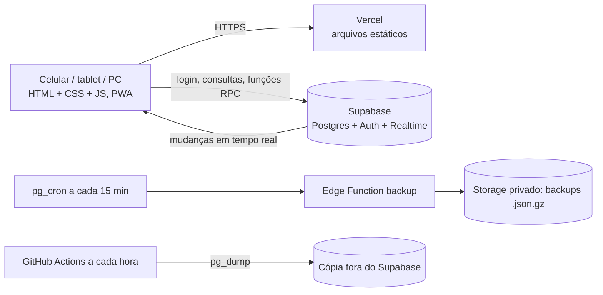
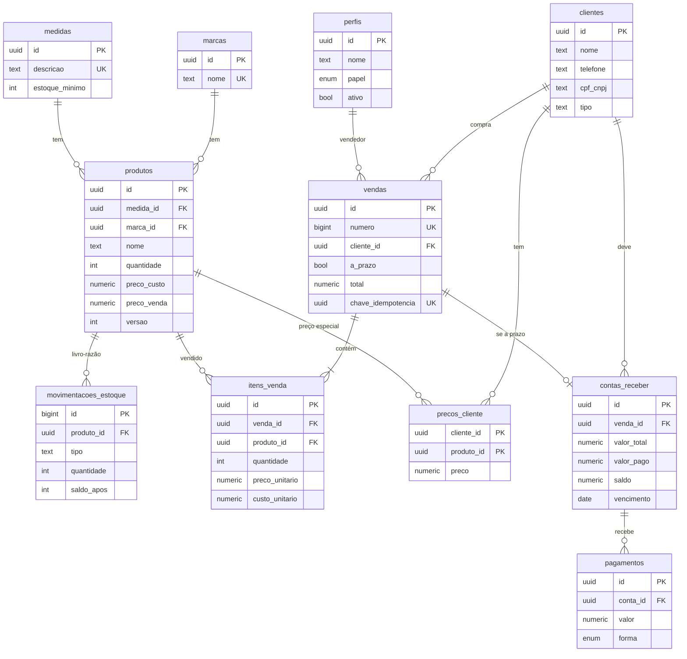

# Arquitetura, modelagem e estrutura

## Visão geral



O navegador nunca calcula estoque nem saldo. Ele só chama funções do banco
(`registrar_venda`, `registrar_pagamento`, `cancelar_venda`, `ajustar_estoque`).
Toda a regra de negócio e a segurança (RLS) ficam no Postgres.

## Diagrama ER



Fase 1 (`004_loja.sql`): `venda_pagamentos` (até 4 formas por venda), `venda_boletos` (parcelas com vencimento próprio), `trocas` (base de troca) e campos de serviços/descontos em `vendas`. Perfis: `admin`, `vendedor`, `cliente`.

Fase 2 (`005_fase2.sql`): `itens_complementares` + `movimentacoes_itens` (insumos, fora do estoque de pneus), `entradas_mercadoria` + `entradas_itens`, `contas_pagar`, `funcionarios` e `comissoes_pagas`. Funções: `ajustar_item`, `registrar_entrada`, `comissoes`, `pagar_comissao`, `alertas_resumo`, `dashboard_adm`.

Tabelas auxiliares: `configuracoes` (limite de estoque, prazo do fiado), `log_alteracoes`
(histórico, imutável) e `backup_log`.

Sobre a lista pedida: **estoque** = `produtos.quantidade` + `movimentacoes_estoque`
(livro-razão). Medida e marca são tabelas próprias; a visão `v_estoque_medida` soma as marcas
de cada medida e é ela que alimenta o alerta de estoque baixo.

## Como o uso simultâneo em vários aparelhos fica seguro

| Risco | Proteção |
|---|---|
| Dois aparelhos vendem o último pneu ao mesmo tempo | `registrar_venda` trava as linhas dos produtos (`FOR UPDATE`, ordem fixa) e baixa com `quantidade >= pedido`; o segundo recebe "estoque insuficiente" |
| Duplo clique ou reenvio após queda de rede | `chave_idempotencia` única: a mesma venda/pagamento nunca é gravada duas vezes |
| Dois aparelhos recebem da mesma conta | `registrar_pagamento` trava a conta; o saldo é recalculado dentro da transação |
| Duas pessoas editam o mesmo produto/cliente | Coluna `versao`: a gravação só vale se a versão não mudou; senão aparece aviso |
| Quantidade alterada "por fora" | Gatilho bloqueia `UPDATE` direto em `quantidade`; só as funções alteram |
| Venda gravada pela metade | Tudo ocorre numa única transação: ou grava tudo, ou nada |
| Tela desatualizada | Supabase Realtime atualiza todos os aparelhos; formulário aberto não é apagado |
| Apagar histórico por engano | Log, movimentações e pagamentos são imutáveis; exclusões são "inativar" |

## Backup em camadas

1. **Livro-razão imutável** (estoque, pagamentos, log): cada operação fica registrada.
2. **Backup a cada 15 minutos** (pg_cron + Edge Function): arquivo `.json.gz` num bucket privado. Retenção: tudo por 48 h, depois 1 por dia até 90 dias. O painel Ajustes avisa se passar 30 min sem backup.
3. **Cópia externa a cada hora** (GitHub Actions, `pg_dump`): protege contra perder o projeto inteiro.
4. **Recomendado em produção: Supabase Pro + PITR** (recuperação a qualquer segundo, via WAL contínuo). Confira preço e disponibilidade atuais no painel do Supabase.
5. **Backup manual** em Ajustes > Baixar backup completo.

## Estrutura de pastas

```
sistema/
├─ public/                  → publicado na Vercel
│  ├─ index.html
│  ├─ manifest.webmanifest, sw.js, icons/   (PWA)
│  ├─ css/app.css           (tema claro/escuro, responsivo)
│  └─ js/
│     ├─ config.js          (URL e chave anon do Supabase)
│     ├─ supabase.js, state.js, ui.js, app.js
│     └─ views/             painel, vendas, atacado, venda_form, nota, estoque, insumos, entradas, pagar,
│                           clientes, fiado, funcionarios, relatorios, ajustes
├─ supabase/
│  ├─ migrations/           001_schema.sql, 002_backup.sql, 003_agendamento.sql, 004_loja.sql, 005_fase2.sql
│  └─ functions/backup/index.ts
├─ .github/workflows/backup-externo.yml
├─ vercel.json
└─ docs/ARQUITETURA.md
```
